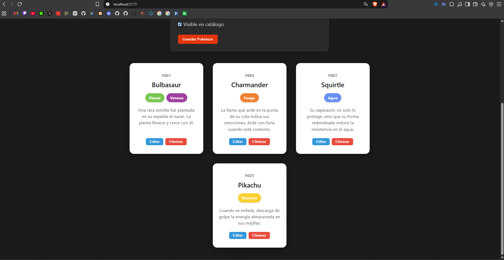
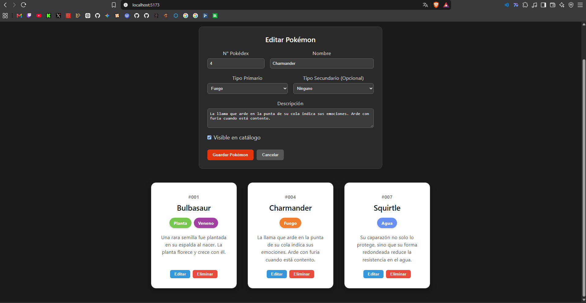
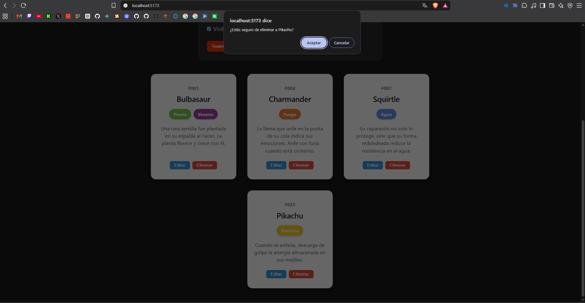

# PokéWiki Web — Integración Full-Stack con CRUD y Autenticación por Token

Aplicación web interactiva Full-Stack desarrollada con **Django REST Framework** en el backend y **React (Vite)** en el frontend, permitiendo la gestión integral (Crear, Leer, Actualizar y Eliminar) del catálogo de Pokémon bajo un esquema de autenticación mediante **Tokens (`rest_framework.authtoken`)** y políticas estrictas de **CORS**.

---

## Arquitectura y Tecnologías

- **Backend:** Django 6.x + Django REST Framework (DRF) + `rest_framework.authtoken` + `django-cors-headers`.
- **Frontend:** React 19 + Vite (`fetch` API con inyección automática de cabecera `Authorization: Token <token>`).
- **Base de Datos:** SQLite3 (Django ORM).
- **Seguridad y CORS:** Endpoints CRUD protegidos con `TokenAuthentication` e `IsAuthenticated`, y acceso CORS restringido exclusivamente al origen local de React (`http://localhost:5173`).

---

## Endpoints de la API REST

### 1. Autenticación
| Método | Endpoint | Acción | Acceso | Descripción |
| :--- | :--- | :--- | :--- | :--- |
| `POST` | `/api/login/` | Iniciar Sesión | Público | Recibe `{ "username", "password" }` y retorna `{ "token" }`. |

### 2. Gestión de Pokémon (`/api/pokemon/`)
*Todos los endpoints siguientes requieren el encabezado `Authorization: Token <token>` (retornan `401 Unauthorized` sin credenciales válidas).*

| Método | Endpoint | Acción | Descripción |
| :--- | :--- | :--- | :--- |
| `GET` | `/api/pokemon/` | Listar | Retorna la lista completa de Pokémon registrados ordenados por número. |
| `POST` | `/api/pokemon/` | Crear | Registra un nuevo Pokémon con validación en servidor. |
| `GET` | `/api/pokemon/{id}/` | Detalle | Obtiene los detalles de un Pokémon por su ID. |
| `PUT` | `/api/pokemon/{id}/` | Actualizar | Sobrescribe y actualiza todos los datos del Pokémon. |
| `DELETE`| `/api/pokemon/{id}/` | Eliminar | Elimina el registro del Pokémon de la base de datos. |

---

## Evidencias de Funcionamiento

### 1. Creación de un nuevo Pokémon (POST)
Operación para añadir una nueva criatura al catálogo mediante formulario con validación:


### 2. Edición de un Pokémon existente (PUT)
Carga de datos del registro en el formulario, modificación y actualización reactiva:


### 3. Eliminación de un registro (DELETE)
Confirmación en navegador y eliminación directa desde la base de datos:


---

## Instrucciones de Ejecución Local

### 1. Clonar el repositorio
```bash
git clone [https://github.com/Kokezz21/pokewiki-web.git](https://github.com/Kokezz21/pokewiki-web.git)
cd pokewiki-web